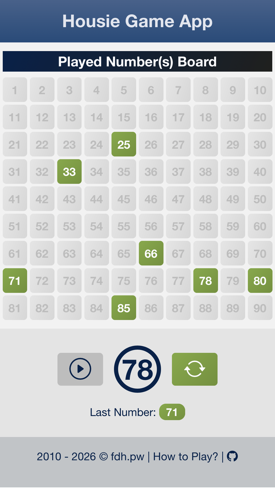
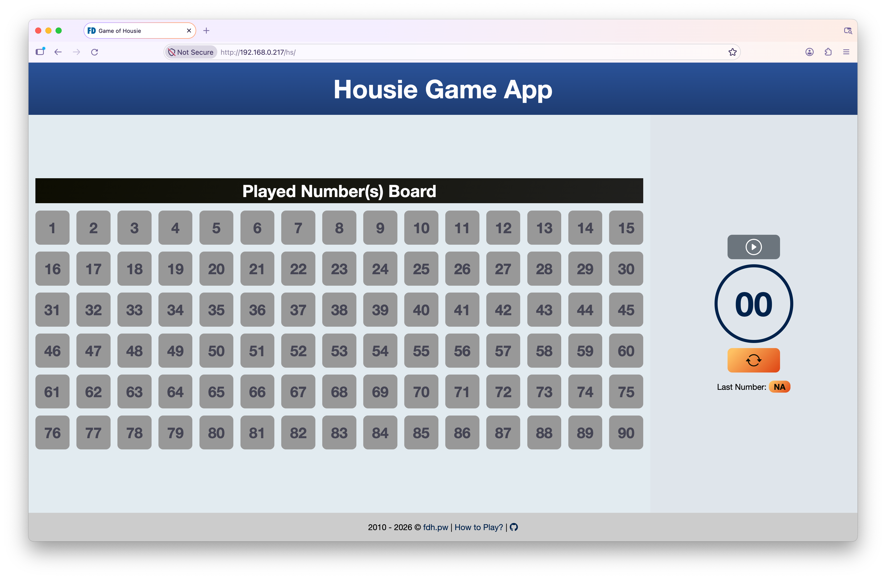

# Game of Housie — Online Tambola Number Generator & Board

A lightweight, zero-dependency Housie / Tambola number caller and 1–90 board web app built with plain HTML, CSS, and vanilla JavaScript. Designed to replace the physical board and balls—whether you're playing on a phone, laptop, or projected screen.

A random number between **1 and 90** is drawn from the remaining unplayed pool (using JavaScript's built-in `Math.random()`) and highlighted on the board.

**Live Demo:** [hs.fdh.pw](https://hs.fdh.pw)

---

## Features

- **1–90 Interactive Board:** Automatically highlights drawn numbers in ascending order and adapts grid layout across desktop, mobile, and portrait/landscape orientations.
- **Unplayed-Only Roulette Spin:** Builds a spin sequence dynamically from remaining unplayed numbers with cubic deceleration before landing on the drawn number.
- **Large Projector-Friendly Spinner:** Oversized number display and spinner ring for easy visibility across a room or on a shared screen.
- **Built-in Voice Caller:** Announces drawn numbers aloud using the browser's `speechSynthesis` API, with a persistent mute/unmute toggle.
- **Last Number & Played Counter:** Displays the previous number called (`NA` at game start) alongside a live `Played: X / 90` badge.
- **Draw History Viewer:** Click the **Played** counter badge to view every drawn number in exact chronological order (`#1`, `#2`, ...) for quick claim verification.
- **Spacebar Shortcut:** Press `Space` to draw the next number hands-free (guarded while modals are open or a draw is in progress).
- **Automatic Local Storage Persistence:** Saves game state (`housie_game_state`) and voice preference (`housie_voice_enabled`) automatically in `localStorage`.
- **Light & Dark Mode:** Uses `color-scheme: light dark`, `light-dark()`, and `oklch()` / `oklab()` color tokens to follow system theme preferences.
- **Zero External Dependencies:** Runs in a single HTML file with inline SVG sprites and native `<dialog>` modals—no frameworks, build steps, or third-party scripts.

## How to Play

1. Open the app and hand out physical Housie/Tambola tickets to players.
2. Click the **Play** button (or press **Spacebar**) to draw a random number between **1 and 90**.
3. Check the board or **Played** history modal whenever a player calls a win.
4. Click the **Reset** button to clear saved progress and start a new game.

## Browser Compatibility

Works in modern desktop and mobile browsers (Chrome, Firefox, Safari/iOS, Edge). Voice announcements require browser support for the Web Speech API (`speechSynthesis`).

---

## 📸 Screenshots

### On Mobile Device

 

### On Desktop Browser

