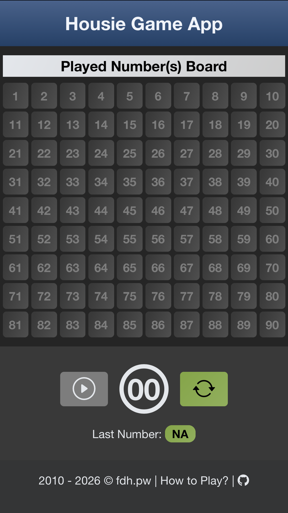

# Game of Housie — Online Tambola Number Generator & Board

A zero-dependency, single-page Housie / Tambola caller and number board (1–90) built with vanilla HTML, CSS, and JavaScript. Designed for mobile screens, projectors, and offline Home Screen use on iOS and desktop browsers.

**Live Demo:** [https://hs.fdh.pw](https://hs.fdh.pw)

## Features

- **1–90 Number Caller & Board:** Responsive 15-column landscape board (10-column portrait) highlighting called numbers and the latest draw.
- **Roulette Spin Animation:** Cycles through remaining unplayed numbers with cubic deceleration before landing on the drawn number.
- **Chronological Draw History:** Inspect the exact order in which numbers were called via the **Played** badge modal to verify claims.
- **Voice Caller:** Optional speech synthesis announcement (`Number X`) with mute/unmute toggle saved in `localStorage`.
- **Theme Cycling (`auto` / `light` / `dark`):** Uses CSS `color-scheme` and `light-dark()` tokens with a dark header toggle button (`#toggle-theme`) and persistent selection.
- **Auto-Save & Offline Ready:** Persists game progress in `localStorage` and caches app assets via a Service Worker (`sw.js`) and `manifest.json` for Home Screen use.

## Controls & Shortcuts

- **Draw Number:** Tap the play button or press `Spacebar`.
- **Draw History:** Tap the **Played** counter badge (`0 / 90`).
- **Voice Toggle:** Tap **Voice On / Muted**.
- **Theme Toggle:** Tap the theme icon button in the header to cycle `auto` → `light` → `dark`.
- **New Game:** Tap the reset button (prompts for confirmation before clearing saved numbers).

## Project Structure

- `index.html` — Markup, responsive `light-dark()` / `oklch()` styles, SVG icon sprite, and game logic.
- `manifest.json` — Web app manifest for standalone display and install metadata.
- `sw.js` — Service Worker for offline asset caching.
- `apple-touch-icon.png` — `180x180` icon for iOS Home Screen bookmarks.

## Browser Compatibility

Works in modern desktop and mobile browsers (Chrome, Firefox, Safari/iOS, Edge). Voice announcements require browser support for the Web Speech API (`speechSynthesis`).

## Local Development

Serve the folder over HTTP or HTTPS (Service Workers do not register over `file://`):

```bash
npx serve .
# or
python3 -m http.server 8080
```

---

## 📸 Screenshots

### On Mobile Device

 

### On Desktop Browser


