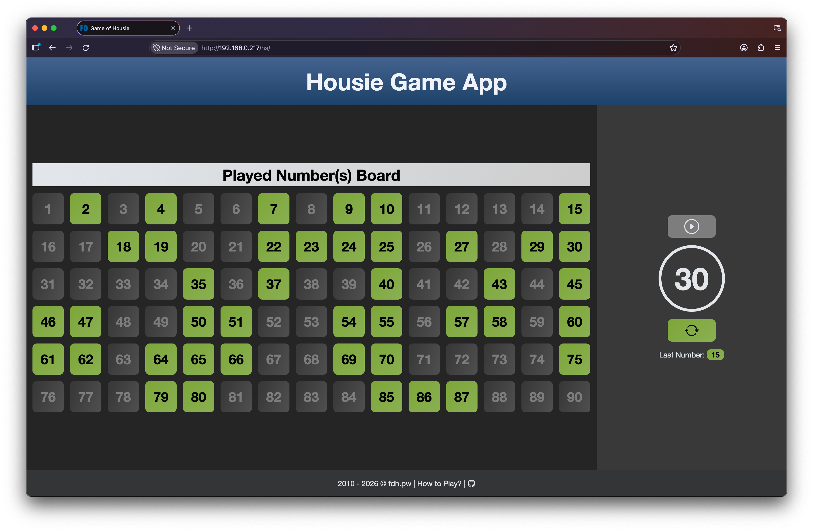

# Play Housie Game

A lightweight, zero-dependency web app that replaces the physical Housie / Tambola board and number balls—so you only need physical tickets to play.

A random number between **1 and 90** is drawn from the remaining unplayed pool (using JavaScript's built-in `Math.random()`) and highlighted on the board.

**Live Demo:** [hs.fdh.pw](https://hs.fdh.pw)

---

## ✨ What's New & Enhanced

* **Zero External Dependencies:** Removed `js-cookie`—game progress is now saved natively using the browser's `localStorage` API, eliminating third-party scripts and cookie overhead.
* **Smart Roulette Spin Animation:** Added a smooth, cubic-decelerating number spin that sweeps exclusively through **unplayed numbers** (with a minimum 10-tick spin even in the endgame) before landing on the drawn number.
* **Instant Collision-Free Draws:** Numbers are picked directly from a remaining-numbers pool rather than guessing and retrying, keeping draws instantaneous right down to the 90th ball.
* **Persistent State & Smart Controls:** Automatically restores your active board, current number, and previous number on reload, and disables the draw button once all 90 numbers have been played.
* **Native Modal & Inline SVG Sprites:** Uses the native HTML `<dialog>` element for the instructions modal and inline SVG sprites (adapted from [Bootstrap Icons](https://icons.getbootstrap.com)) for fast loading without Bootstrap CSS.

---

## 🛠️ Tech Stack

* **HTML5** (Semantic layout & native `<dialog>`)
* **CSS3** (CSS Grid, responsive orientation layouts, and `clamp()` fluid typography)
* **Vanilla JavaScript (ES6+)** (`localStorage`, `Set`, `Promise`-based animations)

---

## 📸 Screenshots

### On Mobile Device

 

### On Desktop Browser

